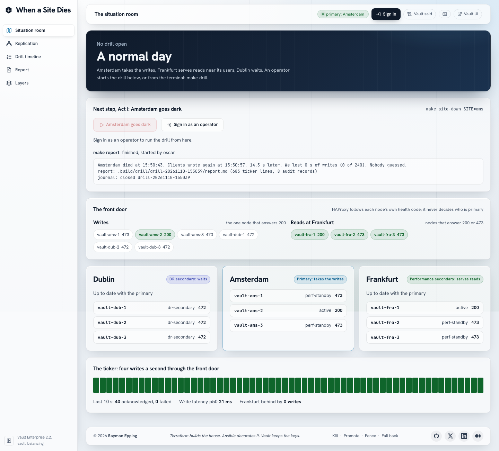

# When a Site Dies

> **Terraform builds the house. Ansible decorates it. Vault keeps the keys.
> Make is the front door.**

A Vault Enterprise 2.2 region failover drill on one Mac. Three sites, each a
three-node Raft cluster with its own seal Vault: Amsterdam is the primary,
Frankfurt a Performance Replication secondary that serves reads near its
users, Dublin a DR Replication secondary that waits. An HAProxy front door
sends writes to whichever node answers 200 on `sys/health`. A ticker writes
four times a second. Then Amsterdam dies, and the lab shows, with measured
numbers, what keeps working, what the operator does, and what was lost.



## The night

| Act | What happens | Vault feature |
| --- | --- | --- |
| 0: A normal day | Writes go to Amsterdam, Frankfurt serves reads, Dublin streams | Performance and DR Replication, performance standbys |
| I: Amsterdam goes dark | `make site-down SITE=ams` kills the whole site, seal Vault included | none (the outage itself) |
| II: The decision | Dublin is promoted with the DR operations token minted before the outage | `sys/replication/dr/secondary/promote` with a batch token |
| III: Frankfurt follows | Frankfurt is pointed at Dublin | `update-primary` with a batch token from Dublin |
| IV: The ghost returns | Amsterdam comes back believing it is primary: fenced first, then demoted and attached to Dublin | a durable fence at the front door, `demote`, `update-primary` |
| V: Back home | A planned failback to the original roles | demote, promote, re-attach, in that order |
| Epilogue: The report | RTO, RPO and every step with Vault's answer | the drill journal, the file audit devices |

**Proves:** a DR promotion needs only a DR operations token minted in advance
(no recovery keys at 3 a.m.); a performance secondary keeps serving reads
while its primary is gone; the front door needs no manual repoint because
each node's health code carries its role; an old primary can be fenced and
demoted without split brain; RTO and RPO are measured, not estimated.
**Illustrates only:** one Mac is not three regions. Network latency, real data
volumes and DNS are not modelled; the numbers describe this lab only.

## Measured

Ten complete drills in a row (`make drill-runs N=10`, `docs/capabilities.md`):

| Measure | Min | Median | Max |
| --- | --- | --- | --- |
| RTO, as clients saw it (s) | 8.8 | 11 | 12.3 |
| Writes lost in the outage | 0 | 0 | 0 |
| Writes lost in the planned failback | 0 | 0 | 0 |

Most of the RTO is detection: HAProxy marks a node down after two failed
health checks a second apart, and killing four containers takes about 3 s.

## Prerequisites

- A Vault Enterprise licence with **Performance Replication**, **DR
  Replication**, **Namespaces** and **Performance Standby** (`make
  license-features` lists them after the first build).
- Podman with at least 16 GiB for its machine (twelve Vaults used under
  1.5 GB together when measured), Terraform 1.14, ansible-core 2.21, the
  vault CLI, Node 24 or later, jq, openssl. `make check` verifies them.
- Free ports on 127.0.0.1: 19100 to 19123 (seal Vaults and nodes), 19130 to
  19132 (the probe), 19180 and 19181 (the front door and its stats), 19190
  (the console), 19191 (the API), 19192 (Keycloak), 19193 (the drill runner,
  127.0.0.1 only). `make ports-check` reports conflicts;
  override any of them in `.env`.

## Quick start

```bash
make env-init            # .env from .env.example; set VAULT_LICENSE in it
make license             # .secrets/vault/vault.hclic, never printed
make gen-certs           # the lab CA and the listener certificate
make lab                 # every phase, then the gates (about 4 minutes from nothing)
make e2e-install         # Playwright and Chromium, once
make show-ready          # before a talk: up, Act 0 validated, verify, the console
make drill               # the night, act by act (DRILL_AUTO=1 for no pauses)
```

The situation room is at `https://localhost:19190/` (`make trust-root` puts
the lab CA in the macOS keychain). Sign in as an operator and press the
drill's next step, or run the same make targets from the terminal
(`docs/RUNBOOK.md`). The fictional people: `ada` (admin) and `oscar`
(operator) may press; `vera` (viewer) may watch. Their passwords are in
`.secrets/identity/users/`.

Who may press is decided by Keycloak, federated from OpenLDAP, both outside
the three sites: when Amsterdam is dead and Dublin is still a DR secondary,
no Vault in the lab accepts a login, so Vault cannot be the authority for the
decision to promote. Ansible still runs every promotion with the DR
operations token, through a small runner on the host that only starts the
next step's make target for a verified operator.

## Daily use

| Command | Does |
| --- | --- |
| `make up`, `make down` | start and stop everything; volumes are kept |
| `make show-ready` | before a talk |
| `make doctor` | what is wrong and which command fixes it |
| `make verify` | end-to-end checks of the running lab |
| `make rehearsal` | the day before: the lab, a whole drill, down and up, the console, the secret scan |
| `make vault-status`, `make frontdoor-status`, `make ticker-status` | each part as it reports itself |
| `make report` | the epilogue of the open drill |
| `make clean-slate CONFIRM=vbal` | remove every `vbal-` container and volume, move credentials aside |

`make help` lists every target.

## Where things are

| Path | Holds |
| --- | --- |
| `config/sites.json` | the topology: three sites and their roles at bootstrap |
| `scripts/phases.txt` | the only phase list `make lab` walks |
| `terraform/seal`, `terraform/platform` | declared structure (seal Transit keys; namespaces, AppRole, policies, audit, paths filter) |
| `ansible/` | order and moment: init, tokens, replication, every act of the drill |
| `compose/` | the site stack (one file for three sites), the front door, the app |
| `app/ticker`, `api`, `web`, `e2e` | the ticker, the read-only API, the situation room, Playwright |
| `docs/` | `STORY.md`, `RUNBOOK.md`, `ARCHITECTURE.md`, `capabilities.md` (the probe's answers and the measurements), `STATE.md` |

## Licence

See [LICENSE](LICENSE).
